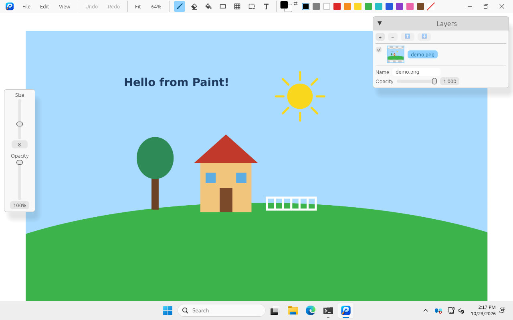
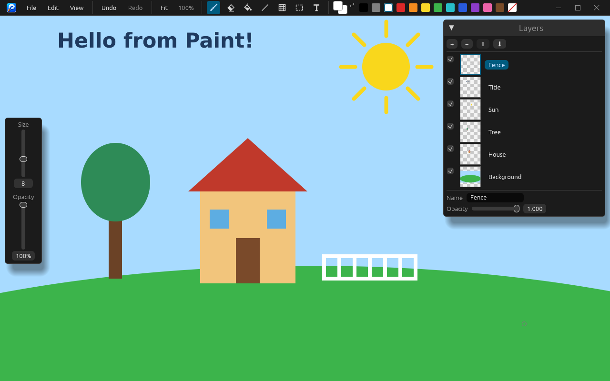
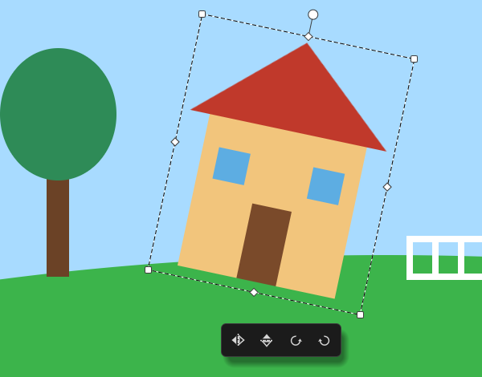
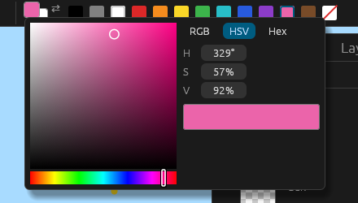
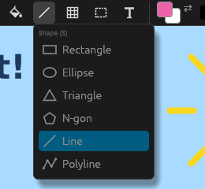

<p align="center">
  
</p>

<h1 align="center">Paint</h1>

<p align="center">
  A simple paint tool, not a Photoshop: fast to load, easy to use.<br>
  Written in Rust with <a href="https://github.com/emilk/egui">egui/eframe</a>, for Windows, Linux and macOS.
</p>

| Windows | Ubuntu |
| --- | --- |
|  |  |

## Features

- **Infinite canvas.** Paint anywhere, pan and zoom freely. 100% zoom is pixel for
  pixel with the screen, also on displays with OS scaling (e.g. 150% on Windows), so a
  pasted screenshot comes out exactly its real size.
- **Tools.** Brush, Eraser, Flood fill, Shapes (rectangle, ellipse, triangle, regular
  n-gon, line, arrow and polyline; outlined or filled), Grid (rectangles, triangles or
  hexagons), rectangle Select and Text.
- **Smooth strokes.** Brush and eraser strokes curve through the mouse positions, so
  fast strokes stay round even with a 125 Hz mouse (can be turned off in Settings).
- **Two colors, like MS Paint.** The left mouse button paints with color 1, the right
  one with color 2. The last palette swatch, **Clear**, makes Fill, Brush, shapes and
  Text erase instead.
- **Layers** with previews: add, delete, reorder, hide, rename and set their opacity.
- **Transform** the selection or a pasted image right on the canvas: move, rotate,
  scale, skew, mirror and turn by 90°.
- **Copy and paste** with the system clipboard, e.g. a partial screenshot from the
  Snipping Tool. Color 2 (white by default) can be made transparent when pasting.
- **Smart fill.** Filling around a shape changes the background color all the way to
  infinity, while enclosed areas keep their look.
- **Open and save** PNG, JPEG and BMP, or drag a file onto the window.
- **Undo and redo** for everything, including layer changes.
- **Compact window.** The toolbar, with its File / Edit / View menus, is also the
  title bar, like in VS Code.
- **Configurable.** Every shortcut can be rebound, and the starting size, opacity,
  font, colors and more can be changed in Settings.

<table>
  <tr>
    <td align="center" width="50%">
      <br>
      <sub>Rotate, scale and skew with handles on the canvas</sub>
    </td>
    <td align="center" width="50%">
      <br>
      <sub>Color picker with RGB, HSV or hex values</sub><br><br>
      <br>
      <sub>Hover a tool to pick its kind</sub>
    </td>
  </tr>
</table>

## Getting started

Ready-made builds for Windows, Linux and macOS are on the
[Releases](https://github.com/cifko/paint/releases) page. The macOS app isn't signed,
so macOS may refuse to open it at first: right-click it and choose **Open**, or run
`xattr -dr com.apple.quarantine Paint.app`.

To build it yourself, you need Rust 1.95 or newer ([rustup](https://rustup.rs)):

```sh
cargo run --release
# or open an image right away
cargo run --release -- picture.png
```

On Linux you may need the usual windowing libraries, e.g. on Debian/Ubuntu:

```sh
sudo apt install libxkbcommon-x11-0 libx11-6 libxcursor1 libxrandr2 libxi6 libwayland-client0
```

## Controls

These are the default shortcuts. Each one can be changed in **Settings → Keyboard
shortcuts**: click it and press the new keys. On macOS, `Ctrl` is `Cmd` and `Alt` is
`Option`.

| Action | Input |
| --- | --- |
| Paint / use the tool | Left mouse button (color 1), right mouse button (color 2) |
| Brush / Eraser / Fill | `B` / `E` / `G` |
| Shape / Grid / Select / Text | `S` / `H` / `M` / `T` |
| Next shape or grid kind | Press `S` / `H` again |
| Rectangle / Ellipse / N-gon / Line / Arrow / Polyline | `R` / `C` / `N` / `L` / `A` / `P` |
| Square, circle, regular shape; lines in 45° steps | Hold `Shift` while drawing |
| Change the brush size | Hold `Alt` and drag left/right or scroll |
| Swap color 1 and 2 | `X` |
| Pan | Middle mouse drag, or `Space` + left drag |
| Zoom | Mouse wheel or pinch, around the cursor |
| Fit everything into the window (up to 100%) / back to 100% | `Ctrl+0` / `Ctrl+1` |
| Select everything that's painted | `Ctrl+A` |
| Copy (active layer) / copy all visible layers | `Ctrl+C` / `Ctrl+Shift+C` |
| Cut / delete the selection | `Ctrl+X` / `Delete` |
| Paste an image from the clipboard | `Ctrl+V` |
| Place / cancel a pasted or moved piece | `Enter` or click outside it / `Esc` |
| Undo / redo | `Ctrl+Z` / `Ctrl+Shift+Z` or `Ctrl+Y` |
| New / open / save / save as | `Ctrl+N` / `Ctrl+O` / `Ctrl+S` / `Ctrl+Shift+S` |

### Using the tools

**Colors.** Left-click a palette swatch to set color 1, right-click it to set color 2.
Click either color in the toolbar to open the picker, which shows RGB, HSV or hex
values.

**Shapes.** Hover the shape button and pick a kind from its menu, or press `S` to
step through them. Drag from corner to corner for a rectangle, ellipse or triangle,
or from end to end for a line or an arrow (the arrow points where you let go). The side panel switches between outlined and filled.
- **N-gon:** set the number of sides (3–20) in the side panel. Click where the first
  vertex goes, then click where the vertex halfway around goes (vertex n/2, rounded
  down). The polygon turns with the mouse, and `Shift` snaps the turn to 15° steps.
- **Polyline:** click to add points. Double-click or press `Enter` to finish, or click
  the first point to close the shape. `Ctrl+Z` removes the last point.

**Grid.** Pick rectangles, triangles or hexagons from the grid button's menu. Click
where the grid starts, size one cell and click, then size the whole grid and click
again. As many whole cells as fit are drawn: a 3×7 cell in a 10×20 area gives 3×2
cells. The count is shown while you move.

**Text.** Click where the text starts and type, like in a text editor. There's no
box: `Enter` starts a new line, and the arrow keys, Home and End move the caret.
`Esc`, a click elsewhere or another tool places the text. The size slider sets the
font size, and the font is chosen in the side panel.

**Selection and pasted images.** Drag inside the selection to move its pixels. Pasted
images float above the active layer until they're placed. Around either one:
- the round handle on top rotates it (`Shift` snaps to 15°);
- the corner squares scale it, keeping the opposite corner in place (`Shift` keeps the
  proportions);
- the edge diamonds skew it;
- the bar below mirrors it or turns it by 90°.

**Fill.** Filling an enclosed area paints it. Filling the open area around shapes
changes the layer's background everywhere, out to infinity, while enclosed areas stay
as they are: draw a circle, fill outside it with red, and the inside stays white.
Filling with Clear erases instead.

**Saving.** Saving flattens the visible layers and crops to what's drawn. PNG keeps
transparency; JPEG and BMP get a white background.

### Window

The toolbar is the title bar: drag its empty space to move the window, and
double-click it to maximize. On Windows and Linux it has its own minimize, maximize
and close buttons, and the window edges resize it. To use the system title bar
instead, turn it on in **Settings → Window**. On macOS the window keeps its own
buttons, drawn over the toolbar's left end.

### App icon

- **Windows:** the icon is built into `paint.exe`.
- **Linux:** docks and taskbars take the icon from a desktop entry, so Paint installs
  one on startup: `~/.local/share/applications/paint.desktop`, plus icons under
  `~/.local/share/icons/hicolor/`. It points at the program you ran and is updated if
  that moves. This also adds Paint to the app launcher and to "Open with" for images.
- **macOS:** the Dock shows the icon while Paint runs. For a `Paint.app` you can put in
  Applications, run `scripts/bundle-macos.sh` on a Mac. CI also builds it, as the
  `Paint-macos` artifact of each macOS run.

## Development

```sh
cargo test
cargo clippy --all-targets -- -D warnings
cargo fmt
```

| File | Contents |
| --- | --- |
| `src/main.rs` | Window setup |
| `src/app.rs` | The UI: toolbar, side panels, canvas input and drawing |
| `src/canvas.rs` | Tiled infinite layers, shape drawing, flood fill, copy and paste |
| `src/floating.rs` | Pasted and lifted pieces, and their transform handles |
| `src/history.rs` | Undo and redo |
| `src/file.rs` | Opening and saving images |
| `src/color_picker.rs` | The color picker |
| `src/text.rs` | Fonts, text layout and editing |
| `src/shortcuts.rs` | Rebindable keyboard shortcuts |
| `src/settings.rs` | Settings, saved between runs |
| `src/titlebar.rs` | The toolbar as the title bar: moving, resizing, window buttons |
| `src/desktop.rs` | The Linux desktop entry and icons |

The Windows screenshot above is taken by the `Screenshots` workflow: it opens
`docs/screenshots/demo.png` in a release build on a Windows runner and attaches the
capture to the run as the `windows-screenshot` artifact, to download and commit as
`docs/screenshots/windows.png`.

### Releasing

Run the **Release** workflow from the Actions tab (**Run workflow**). Enter the version
(e.g. `0.2.0`) or leave it empty to use the one in `Cargo.toml`. It builds Windows,
Linux and macOS (Apple Silicon and Intel) packages and creates the `v<version>`
release with them attached and notes generated from the commits. It's a draft unless
you untick **draft**, so you can check it and publish it from the Releases page.

<p align="center">
  <a href="https://www.buymeacoffee.com/cifko"></a>
</p>
